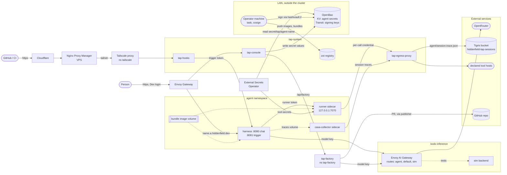

# tap: Architecture

How the platform fits together today. The [design doc](Agent-as-OCI%20+%20Harness%20Design.md) has the reasoning and the [implementation plan](implementation-plan.md) has the history and findings per phase; this page is the map. For operating it, see the [runbook](runbook.md).

## The idea

An agent is data, not an image. Its bundle (`agents/<name>/` in [tap-agents](https://github.com/ipedrazas/tap-agents): `agent.yaml`, `system.md`, skills, tool scripts, fixtures) is pushed to the registry as an OCI artifact and mounted read-only into a pod built from two curated images:

- **`tap-harness`** runs the model loop. It never runs tools.
- **`tap-runner`** runs the tools the bundle declares, each as its own uid, and nothing else.

Everything an agent can reach (hosts, secrets, write effects) is declared in `agent.yaml`, checked by `tapctl validate`, rendered into Kubernetes objects by `tapctl render`, and enforced at runtime.

## Topology

The cluster is k3s on the LAN with gVisor (`runtimeClassName: gvisor`) for agent pods. Nothing in it is reachable from the internet except `tap-hooks`, through the path at the top of the diagram.

## Components

| Component | Where | Job |
| --- | --- | --- |
| `tap-harness` | agent pod | Model loop through the `kodo-inference` AI gateway, skills, sessions, the effects policy. Serves chat on `:8080` (behind the gateway and Dex) and, when hooks are on, the trigger port `:8081`. |
| `tap-runner` | agent pod, native sidecar | Runs declared script tools and remote MCP tools. Tool *i* runs as uid `61000+i`; secret files are `0440 root:fsGroup`, so tools can't read the runner token, the egress key or each other's secrets. |
| `tap-egress-proxy` | `tap-system` | CONNECT-only proxy, the only way out for tool traffic. Each call carries a credential naming agent and tool; the proxy allows only that tool's declared hosts and refuses private addresses. Reads allowlists from labelled ConfigMaps and agent keys from OpenBao (role `tap-egress-proxy`). |
| `tap-console` | `tap-system`, `tap.hiddenfield.dev` | Inventory of running agents and per-agent settings: display title, secret values (to OpenBao, write-only), hooks, egress edits (as PRs), and run history (session traces from the bucket, owning team only). Also the factory form. |
| `tap-hooks` | `tap-system`, `hooks.hiddenfield.dev` | Public webhook receiver. Verifies, filters, dedups and rate-limits deliveries, renders the hook's prompt and starts a turn on the agent's trigger port. |
| `tap-factory` + publisher | `tap-factory` | Turns a spec into a PR adding `agents/<name>/` to tap-agents. It checks out tap-agents and the `platform.yaml` of the tap release it pins. The publisher sidecar is the only holder of the GitHub token. |
| Envoy AI Gateway | `kodo-inference` | The only path to models. The harness and the factory call it with their own client keys; the route (`agent`, `default`, `sim`), picked with `x-ai-eg-model`, maps to a backend: OpenRouter for real models, `sim` for cheap tests. Tools can reach it on the network but have no key. |
| Sessions bucket | Tigris (`t3.storage.dev`), `hiddenfield-tap-sessions` | Each harness writes its sessions as casa trace documents to a `traces` volume after every turn. The `casa-collector` sidecar uploads them to `<agent>/<session_id>.trace.json` through the egress proxy (scope `collector:sessions`) and is the only container with the write key. `task sessions:pull` downloads them. |
| zot | `tap-system`, `registry.hiddenfield.dev` | OCI registry for curated images (`tap/*`) and bundles (`agents/*`). Anonymous reads, authenticated pushes. |
| Kyverno + native policies | cluster | Admission: images and bundles by digest from our registry, signed (see Supply chain). |
| OpenBao | outside the cluster, `openbao.alacasa.uk:8443` | Agent secrets (KV, synced by External Secrets) and the signing keys (Transit). |

## An agent pod

`tapctl render agents/<name>` produces namespace `agent-<name>` with:

- a Deployment with one pod: the harness container and the runner as a native sidecar, both mounting the bundle (`image` volume, by digest) read-only, plus, when sessions are on, the `casa-collector` native sidecar, which reads the harness's `traces` volume (the runner never mounts it);
- Secrets, all declared by External Secrets objects, so the output applies as is (`kubectl apply` or a GitOps agent): `model-credentials` (harness only), `trigger-token` (harness only, when hooks are on), `sessions-credentials` (casa-collector only), all read from OpenBao `secret/tap-platform/`; `tool-secrets` (runner, from `secret/tap/agent-<name>/`); `runner-token` (both, loopback auth) and `egress-key` (runner and casa-collector), generated once in the namespace by ESO `Password` generators. A `PushSecret` copies the egress key to OpenBao `secret/tap-egress/agent-<name>` for the proxy;
- ConfigMap `tap-system/egress-policy-<name>` (label `tap.hiddenfield.dev/egress-policy`): the allowlist the egress proxy enforces;
- NetworkPolicies: default deny; egress to DNS, the model gateway and the egress proxy; ingress from the gateway on `:8080` and from `tap-system/tap-hooks` on `:8081`;
- a Service and an HTTPRoute `<name>.a.hiddenfield.dev`, which the gateway-level Dex `SecurityPolicy` (`deploy/platform/infra/auth.yaml`) covers.

The harness asks the runner to run a tool; the runner mints a per-call egress credential and runs the script with an empty environment apart from that credential (`HTTPS_PROXY`, `NO_PROXY`), declared secrets, `PATH`, its own `HOME` and `TMPDIR`, `LANG`, `TAP_WORKSPACE`, `TAP_CALL_ID`, `NODE_NO_WARNINGS` and `PYTHONDONTWRITEBYTECODE`. Secret names can't shadow any of these (rule 3).

## Request paths

**Chat.** Browser → Envoy Gateway (Dex OIDC, `x-tap-identity`, verified by the gateway's JWT provider) → harness `:8080` (`POST /v1/chat`, SSE) → model and tools → answer. Each turn's trace is uploaded to the sessions bucket. The harness answers 401 without an identity and 403 to callers from its own pod (tools share its network). The operator chats from inside the pod with `kubectl exec deploy/agent -c harness -- tap-harness chat MESSAGE`, which goes through a Unix socket in the harness container's `/tmp` (`agent:smoke` does this).

**Hook.** GitHub → Cloudflare → NPM (TLS for `hooks.hiddenfield.dev`) → Tailscale operator proxy → `tap-hooks` `POST /h/<agent>/<hook>`:

1. Look up the hook (unknown or disabled: 404), read at most 1 MiB (8 bodies at once, else 503), verify the GitHub HMAC or bearer token (401).
2. `ping` → 200 `pong`; event not in the filter → 200 `ignored`.
3. Dedup on delivery ID and body hash (200 `duplicate`), rate limit 30/min per hook (429).
4. Render the prompt template, `POST /v1/trigger` on the agent's `:8081` with the shared trigger token.
5. The harness answers 202 with a session ID and runs the turn in the background as user `hook:<name>`, at most two at a time per agent (429 → tap-hooks answers 503 with `Retry-After`).

Hook settings live in ConfigMap `tap-system/agent-settings` (`<agent>.hook.<name>`), credentials in Secret `tap-system/agent-hooks` (`<agent>.<name>`; bearer tokens stored as SHA-256). The console may patch that Secret but not read it; tap-hooks may only read it.

**Effects.** Tools are `read`, `write` or `irreversible`. `effectsPolicy` in `agent.yaml` decides per level: `auto`, `deny`, or `ask` (not implemented, so it behaves as deny). Hook runs have no one to ask, so an agent that should write from a hook needs `auto`, and the credential it writes with is what bounds the blast radius (gh-pr-agent: a fine-grained token scoped to the reviewed repositories).

## Supply chain

- `task images:push` builds the harness, runner and collector images, signs each with the **build** key and pins their digests in `platform.yaml`. The platform services (the apps layer) are built only by CI on main, under a tag that hashes their inputs; CI signs only what it built and refuses a tag it finds unsigned, and zot doesn't let the operator push them.
- Agents deploy through GitOps: tap-agents' publish workflow (on merge to main) builds, tests and signs bundles in CI, then publishes every agent's rendered manifests as one signed OCI artifact (`tap/agents-manifests:main`). Flux (`deploy/flux`) verifies that signature and applies the artifact as `tap-agents-applier`, which can manage only the kinds `tapctl render` emits. Flux prunes removed agents and reverts drift.
- `task agent:push` builds and signs a bundle with the **build** key. `task agent:test` runs its fixtures in the real runner image under gVisor; a passing run is signed with the **tested** key and gets an in-toto attestation (spec hash, runner image, fixture results, permission diff, source commit).
- Both keys are OpenBao Transit keys (`tap-transit/keys/tap-build`, `tap-tested`), not exportable; cosign signs through `hashivault://`. tap-agents' CI builds, tests and signs bundles with a short-lived OpenBao token from GitHub OIDC; `agent:push` and `agent:test` on the operator's machine use the token in the macOS Keychain. Their public halves are pinned in `platform.yaml` `signing.*`.
- Admission: native `ValidatingAdmissionPolicy` requires every image to be `registry.hiddenfield.dev/tap/*@sha256:…` and exactly one bundle from `agents/*` by digest; Kyverno checks the build signature on everything and the tested signature on the bundle. `signing.admission` is `audit` today (Kyverno stalls on some uncached registry lookups; see phase 7).
- An agent's `runner.image` must be one of the runner digests in `platform.yaml` (validation rule 6), so re-pinning the runners means re-testing every agent.

## Secrets

| Secret | Lives in | Read by |
| --- | --- | --- |
| Agent tool secrets | OpenBao KV `secret/tap/agent-<name>/<key>` | runner, via ExternalSecret `tool-secrets`; the console writes values, never reads |
| Signing keys | OpenBao Transit `tap-transit` | cosign in CI (GitHub OIDC) and on the operator's machine (policies `tap-signer`, `tap-tested-signer`) |
| Operator token | macOS Keychain, service `tap-openbao` | `deploy/openbao/token.sh` |
| Model key | `tap-system/model-credentials`, pushed to OpenBao `secret/tap-platform/model-credentials` | harness, via ExternalSecret |
| Hook credentials | `tap-system/agent-hooks` | tap-hooks |
| Trigger token | `tap-system/hooks-trigger-token`, pushed to OpenBao `secret/tap-platform/trigger-token` | tap-hooks; harness, via ExternalSecret `trigger-token` |
| Egress keys | per agent `egress-key` (generated), pushed to OpenBao `secret/tap-egress/agent-<name>`; the factory's in `tap-system/egress-keys` | runner, casa-collector; egress proxy from OpenBao |
| Sessions bucket keys | `tap-system/sessions-credentials` (write, pushed to OpenBao `secret/tap-platform/sessions-credentials`), `tap-system/sessions-reader` (read) | casa-collector, via ExternalSecret; console and casa |
| Registry push password | `.tap/registry.pass` | `task registry:login`: agent bundles; zot refuses it for the platform's images |

`.tap/registry.pass` is the operator's registry password; the rest of `.tap/` is derived. `task registry:creds --force` regenerates the CI passwords too, so run both `ci:onboard` tasks after it (runbook, "Known failures").

## Configuration

- `platform.yaml`: registry, domains, model routes, pinned image digests, signing keys and admission mode, OpenBao, sessions bucket, hooks public URL, console teams.
- `agents/<name>/agent.yaml` in tap-agents: one agent's contract; schema in `schema/agent.v1.json`, rules in `pkg/spec`. tap-agents pins a tap release (`tap.version`), whose `platform.yaml` its CI and the factory validate against.
- `deploy/platform`, `deploy/factory`: kustomize for `tap-system` and `tap-factory`, each split in two. `infra/` (namespaces, RBAC, routes, gateway, zot, OpenBao and ESO objects) is applied by `task platform:up` and `task factory:deploy`. `apps/` (the services' Deployments, Services and NetworkPolicies, and the `tap-platform` ConfigMap generated from `platform.yaml`) names images without a digest; `deploy/apps.sh render` sets each to the digest of its input tag. The platform workflow publishes the result as the signed artifact `tap/platform-manifests:main`, and Flux applies it (`deploy/flux/platform.yaml`) as `tap-platform-applier`, which can manage only those kinds in `tap-system` and `tap-factory`. `task platform:apps` is the break-glass path.
- Console-owned state: `tap-system/agent-settings` and `tap-system/agent-hooks`.
