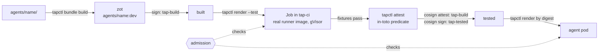

# tap: Bundles and signing

What an agent bundle is, how it gets from a directory in git to a running pod, and why the cluster only runs bundles we have signed. For the wider picture see [architecture.md](architecture.md); for the history and the Kyverno findings, phases 7 and 8 of the [implementation plan](implementation-plan.md).

## Why bundles

An agent is data, not an image. Everything that makes `gh-pr-agent` different from `weather-agent` (manifest, prompt, skills, tool scripts, fixtures) lives in `agents/<name>/`. The code that runs it is two curated images shared by every agent:

- `tap-harness` runs the model loop and never runs tools;
- `tap-runner` (`runner-node`, `runner-python`, `runner-base`) runs the tools the bundle declares and nothing else.

The bundle is pushed to the registry as an OCI artifact and mounted read-only into both containers as an image volume. This buys us:

- **No per-agent images.** Nobody writes a Dockerfile for an agent, and an agent can't bring its own interpreter, base image or setuid binary. The only executables in a pod are the ones in curated images that we built and pinned in `platform.yaml`.
- **One thing to review.** The bundle is a few text files. A PR shows exactly what the agent will be told, which tools it can call, which hosts each tool can reach and which secrets it gets.
- **An agent can't change itself.** The bundle is read-only to the harness and the runner, so a model can't rewrite its own prompt, skills or tools.
- **Digests mean something.** Bundles are reproducible (below), so a digest identifies the exact content, and the pod spec refers to the bundle by digest. Rollback is redeploying the previous digest; nothing is rebuilt.

## What's in a bundle

`tapctl bundle build` (`pkg/bundle`) turns the source directory into a one-layer OCI image. containerd only mounts directory subpaths of an image volume, so the layout is projected into one directory per consumer:

| Path in the image | Contents | Mounted by |
| --- | --- | --- |
| `harness/` | `agent.yaml`, the system prompt, the declared skills, pinned MCP schemas | harness |
| `runner/` | `agent.yaml`, `tools/`, `mcp/`, `node_modules/`, `vendor/` | runner |
| `tests/` | fixtures | the test Job only |

Tools are never mounted into the harness. Fixtures are in the image, even though production pods don't mount them, so the digest that was tested covers the tests that ran. Anything else in the source directory stays in git.

The build is **reproducible**: every entry gets mtime 0, the same mode and a sorted position; the layer is uncompressed; the config and annotations carry no build time. The same sources always give the same digest, on any machine. `tapctl attest` relies on this: it rebuilds from the working tree and refuses if the result isn't the digest that was tested.

The manifest is annotated with the agent name and `tap.hiddenfield.dev/spec-hash` (a hash of `agent.yaml`), plus the usual `org.opencontainers.image.*` title and version.

**Tags.** Bundles live at `registry.hiddenfield.dev/agents/<name>`. `task agent:push` pushes under `metadata.version` and refuses to overwrite a version tag that points at different content: bump the version instead. `agent:test` (and so `agent:launch` and `agent:dev`) pushes to the moving tag `dev`. Tags are only for humans; everything downstream uses the digest, written to `.tap/<name>.digest`.

## From git to a pod



1. **Build and push.** `tapctl bundle build --push` writes the digest to `.tap/<name>.digest`.
2. **Sign as built.** cosign signs the digest with the **build** key. Every curated image gets the same signature at `task images:push`.
3. **Test.** `tapctl render --test` produces a Job in `tap-ci` that runs every fixture in the agent's real runner image under gVisor, with the bundle mounted by digest. Admission checks the Job too, but only for the build signature, since the tested one doesn't exist yet.
4. **Attest.** If the Job completes, `tapctl attest` writes an in-toto predicate (below) and cosign attaches it, signed with the build key.
5. **Sign as tested.** cosign signs the same digest with the **tested** key. Only this step uses that key.
6. **Deploy.** `tapctl render --bundle-file .tap/<name>.digest` emits the agent's manifests with the bundle and every image by digest; `task agent:deploy` applies them.

`task agent:verify AGENT=<name>` runs the checks admission runs and prints the attestation.

Signing is skipped when a valid signature already exists. ECDSA signatures differ every time, so re-signing would pile up signatures on the same digest.

## Why sign

The pipeline is split so that nothing that writes an agent can deploy one. The factory's authority ends at a PR; it has no registry, cluster or signing credentials. Signatures carry that split into the cluster: admission doesn't trust whoever ran `kubectl apply`, it checks that the bundle and images are ones the pipeline produced and tested.

Concretely, signing stops:

- an image or bundle that didn't come from our build (a typo'd registry, a tag someone moved, a hand-pushed artifact);
- a bundle that was built but never passed its fixtures in the real runner image;
- a pod that swaps in a different harness or runner, or adds a sidecar, ephemeral container or second bundle.

It doesn't stop a bad agent that passes its fixtures. That's what PR review of `agent.yaml` and the permission diff are for.

## The two keys

| Key | Signs | Meaning |
| --- | --- | --- |
| `tap-build` | every bundle at push, every curated image, the attestation | "our pipeline built this" |
| `tap-tested` | a bundle, once its fixtures pass | "this exact digest passed its fixtures in the real runner under gVisor" |

Why a second key instead of checking the attestation: Kyverno 1.19 can't verify attestations signed with a plain key and no transparency log (`cosign bundle verification failed`, also on `main`). A signature by a key that only the test step uses gives admission the same yes/no. The attestation is the record behind it. The tested signature carries an annotation with the predicate's SHA-256 so a person can link the two; admission doesn't check it, because Kyverno compares annotations with the OCI descriptor, not the signed payload.

**No Rekor, no Fulcio.** The registry and cluster are private. Public Rekor would publish our image names and digests, and keyless signing would tie signatures to an OIDC identity we'd then have to run. Signatures are verified with `--insecure-ignore-tlog`, which is correct for offline keys, not a shortcut.

## The attestation

Predicate type `https://tap.hiddenfield.dev/attestations/bundle/v1` (`pkg/attest`):

- **agent**: name, version, owner; **bundle** digest; **specHash**; **runner** image;
- **fixtures**: passed, failed, skipped, and where they ran (`cluster:tap-ci/<job>`). They're parsed from the Job log, and a summary that disagrees with the per-case lines is an error, so a truncated log can't pass;
- **permissions**: the diff against a base (`git:origin/main` by default): whether it widens hosts, secrets or effects, and the list of changes;
- **builder**: git user, tapctl version, host, time; **source**: repo, commit, dirty flag.

`tapctl attest` refuses when any fixture failed or when the sources don't rebuild to the tested digest.

## Where the keys live

Both keys are **OpenBao Transit keys** (`tap-transit/keys/tap-build`, `tap-tested`). They aren't exportable, and nothing ever holds the private halves: cosign signs through `hashivault://<key>`, so OpenBao does the signing and returns a signature.

- Policies `tap-signer` and `tap-tested-signer` allow signing with one key each.
- The operator token (Keychain, `deploy/openbao/token.sh`) has both. Every signing task renews it, so it only expires after 32 days unused; then run `task openbao:onboard` again.
- The public halves are pinned in `platform.yaml` `signing.publicKey` and `signing.testedPublicKey`. That's what admission trusts. `.tap/cosign.pub` and `.tap/cosign-tested.pub` are derived from it.
- Before every signature, `signing:check` makes sure the Transit key is still the one pinned in `platform.yaml`. If it isn't: `task signing:pin`, commit, `task admission:apply`, `task images:sign`.

Losing `.tap/` costs nothing; there's no private key on disk.

## Admission

Two layers, so the cheap check keeps working when the expensive one is down:

- **Native `ValidatingAdmissionPolicy`** (`tap-registry-pods`, `tap-registry-workloads`): every image must be `registry.hiddenfield.dev/tap/*@sha256:…`, and the pod must mount exactly one `registry.hiddenfield.dev/agents/*@sha256:…` bundle. No registry calls. Covers ephemeral containers.
- **Kyverno `ImageValidatingPolicy`** `tap-agents`: every image and the bundle carry a valid build signature, and the bundle carries a valid tested signature. A CEL extractor reads image volumes, which is why we use Kyverno rather than the sigstore policy-controller (that one only checks containers). `tap-ci` requires only build signatures.

Kyverno only sees namespaces labelled `tap.hiddenfield.dev/admission=verify`; `tapctl render` sets the label.

**Previews** are the one place a bundle runs without the tested signature. `task agent:preview` deploys a PR's agent as `<name>-dev` in `agent-<name>-dev`, labelled `tap.hiddenfield.dev/preview=true`. There, the Kyverno policy `tap-previews` requires the build signature only, and `tap-agents` doesn't apply. A preview has its own secrets, egress key and allowlist, never the real agent's. Only the operator starts previews: Flux's applier can create agent namespaces, but its admission policy refuses the preview label (`deploy/flux/applier-policy.yaml`). Policies are generated by `tapctl admission policy` and applied with `task admission:apply`.

## Limits today

- **Admission is in audit mode** (`signing.admission: audit`). Violations go to PolicyReports; nothing is rejected. Enforce is blocked on Kyverno hanging on about one in three uncached registry lookups (phase 7). Until enforce is on, signing tells us what's wrong but doesn't stop it.
- **The operator token still holds both signers.** CI now signs, each job with only the key it needs, but the operator token can still use both, so on the operator's machine the split is enforced by the Taskfile, not by OpenBao. What's left is removing `tap-tested-signer` from the operator token (gitops plan, phase 4).
- **Signing happens on the operator's machine.** The attestation records which machine and whether the tree was dirty, but nothing stops an operator from testing a branch that isn't `main`. `agent:launch` checks this; `agent:dev` doesn't.
- Admission doesn't check that an attestation's agent matches the namespace, and doesn't look at the permission diff.
- Ephemeral containers must be curated images by digest, but their signatures aren't checked.

## Checking by hand

```bash
task agent:verify AGENT=<name>                         # both signatures + the attestation
cosign verify --key .tap/cosign.pub --insecure-ignore-tlog <ref@sha256:…>
cosign verify --key .tap/cosign-tested.pub --insecure-ignore-tlog <ref@sha256:…>
cosign tree <ref@sha256:…>                             # signatures and attestations attached to a digest
task admission:status                                  # policies and audit results per namespace
```
